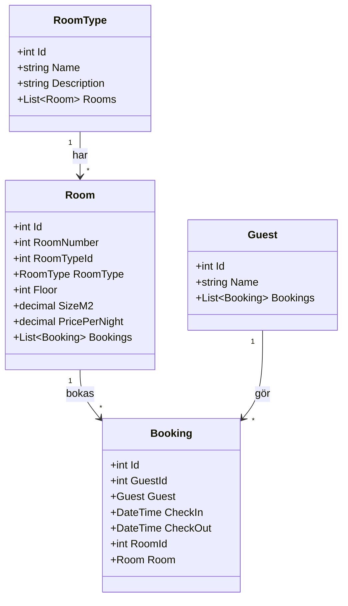

# Hotel Grandioso — Inlämning 1

**Namn:** [Samar Hussein]

## Så kör du projektet

1. Forka repot på GitHub och klona din fork
2. Öppna `HotelGrandioso.slnx` i Visual Studio (eller öppna mappen i VS Code)
3. Tryck **F5** för att starta

Via terminalen:

```bash
dotnet run --project HotelGrandioso
```

## Databas

- Databas: SQLite
- Migrationer: Migrationerna finns i mappen Migrations och körs automatiskt när programmet startar.

## UML-klassdiagram



```

## GDPR
Det är viktigt att tänka på GDPR när gästernas personuppgifter hanteras. Därför samlas endast information in som behövs för att kunna hantera hotellbokningar.

Gästens namn sparas för att kunna se vem bokningen tillhör. Däremot samlas inte onödig information in, till exempel Religion, HairColor eller HeightCM, eftersom dessa uppgifter inte har någon betydelse för hotellbokningen. Religion är dessutom en känslig personuppgift som kräver extra skydd. På så sätt följs principen om dataminimering och vi ser till att inte spara mer information om gästerna än vad som faktiskt behövs.

>

## Designmönster
Jag använder Repository mönster genom klassen HotelRepository. Där finns metoderna GetRooms(), GetBookings(), AddBooking(),RemoveBooking() och CalculateTotalPrice() för att hantera information i databasen.

I Program.cs skapas först databaskopplingen och sedan skickas den vidare till HotelRepository. Därefter skickas repository vidare till HotelMenu, som använder metoderna för att hantera användarens val.

Jag valde detta sätt för att dela upp koden och göra programmet enklare att förstå och ändra.

>

## Tekniker

- C# / .NET 10
- Entity Framework Core
